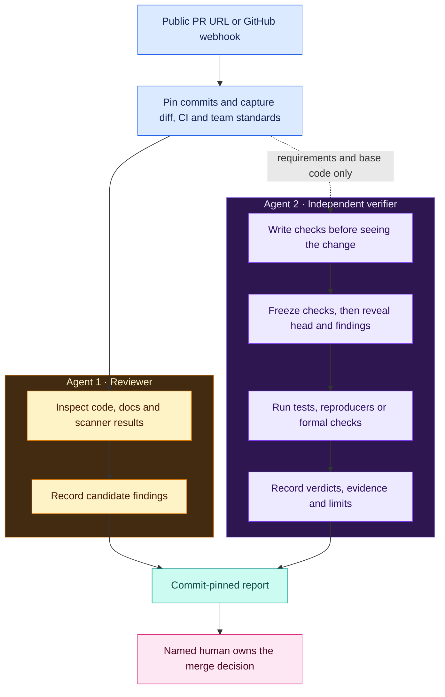
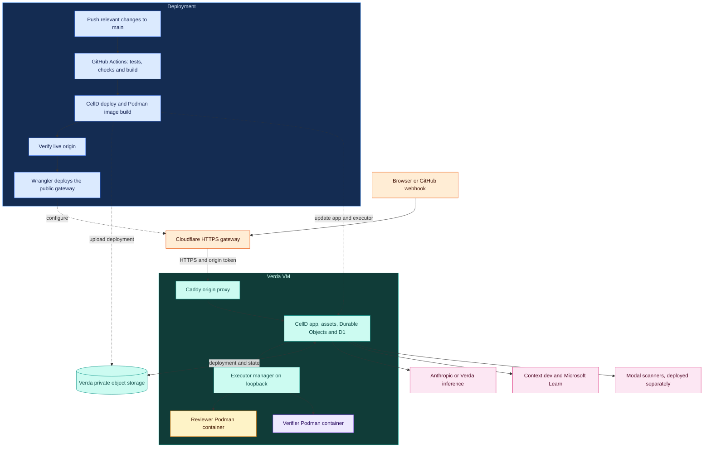

# Bumble Bot

Our submission for [Tieto's Earned Trust in AI Code challenge at Junction 2026](challenge/earned-trust-in-ai-code.md) is an AI-powered pull request reviewer. We want developers to trust its findings and spend less time dismissing noisy comments.

The idea is to give reviewers evidence they can inspect. Bumble Bot combines code review, independent verification, tests, documentation lookups, and deterministic checks. A named human still owns the decision to merge.

## Try it

Visit [review.oliinyk.dev](https://review.oliinyk.dev/), paste a link to a public GitHub pull request, and watch the review run. Give it some time. Checking findings takes longer than generating comments.

The AI reviewer accepts code in any language. Built-in deterministic checks cover **JavaScript, TypeScript, Python, and C#/.NET**, plus GitHub Actions workflows. For other languages, the agent can review the code and attempt additional checks, but execution depends on the project's toolchain and dependencies. The report shows which checks ran and which could not run.

Bumble Bot also works as a [GitHub App](https://github.com/apps/bumble-bot-review), but we are not offering installation on other repositories yet. You can see it working in this repository:

- [PR #53](https://github.com/oliynykmax/junction-2026/pull/53) has multiple review rounds, findings, and the bee ASCII artwork. Compare the [first review](https://github.com/oliynykmax/junction-2026/pull/53#pullrequestreview-5909238196) with the [next review](https://github.com/oliynykmax/junction-2026/pull/53#pullrequestreview-5909242788).

## How it works

The two lanes show separate agents. The reviewer starts the verifier after recording its findings. The verifier writes its initial checks before seeing the proposed change.



### Code review

Our review prompt builds on Cursor's [thermo-nuclear code quality review skill](https://github.com/cursor/plugins/blob/main/cursor-team-kit/skills/thermo-nuclear-code-quality-review/SKILL.md), with our own changes. Our team has used AI review tools before, and no single prompt covers every repository or kind of change. We ask the reviewer to explain each finding's impact, evidence, and proposed fix.

### Independent verification

A separate verifier writes checks from the pull request's stated requirements before it sees the proposed implementation. It then runs those checks against the PR's head commit and tries to reproduce the reviewer's findings.

For suitable changes, the verifier can use formal methods. It states a property that must hold, checks the code or a model of its behavior, and looks for a counterexample. The report records the method, command, result, assumptions, and limits, including checks that did not run.

The verification record supports [TLA+](https://lamport.azurewebsites.net/tla/tla.html), [Dafny](https://dafny.org/), [Verus](https://github.com/verus-lang/verus), [Kani](https://model-checking.github.io/kani/), [Gobra](https://github.com/viperproject/gobra), [Nagini](https://github.com/marcoeilers/nagini), [Frama-C](https://www.frama-c.com/), and [CBMC](https://www.cprover.org/cbmc/), as well as property tests and other checks. The agent chooses a relevant method rather than running every tool on every PR.

A passing check covers its stated scope and assumptions. It does not prove that the entire pull request is correct. Checker results are agent-reported, so readers still need to inspect the evidence.

We drew inspiration from [AI-assisted CPython formalization in Lean](https://discuss.python.org/t/formalizing-cpython-in-lean-findings-from-a-machine-checked-model-and-how-youd-like-them/109978) and [Bend's work on proofs for AI-generated code](https://github.com/bendlang/bend).

### Tests

Existing tests can share the implementation author's blind spots. The independent verifier adds checks based on the stated requirements and uses reproducers or property tests to investigate suspected defects. This gives the review another source of evidence beyond the author's test suite.

### Documentation

LLM knowledge can become stale. The reviewer consults documentation to check claims about library behavior, language features, and version-specific contracts. The report lists the documentation consulted so you can follow the same sources.

### CI and deterministic checks

Bumble Bot captures CI results for the exact commit under review and runs applicable scanners. The current scanner set includes [zizmor](https://github.com/zizmorcore/zizmor) for GitHub Actions, [ty](https://github.com/astral-sh/ty) for Python types, and [oxlint](https://oxc.rs/docs/guide/usage/linter) for JavaScript and TypeScript linting.

The reviewer must confirm scanner diagnostics or dismiss them with a reason. Failed or unavailable checks remain visible in the report. See the [scanner documentation](scanner/README.md) for details.

## Deployment

Cloudflare provides the public HTTPS gateway. The app and isolated agent containers run on Verda, while Modal runs the scanners. CI verifies the Verda origin before updating the gateway.



See the [Verda deployment guide](docs/celld-deployment.md) for setup and recovery details.

## Customize the review

Add a `CODING_STANDARDS.md` file at the root of your repository to provide your team's review criteria. Bumble Bot reads the file from the PR's base commit, so a change cannot rewrite the rules used to review itself.

You can also discuss findings with `@bumble-bot-review` in a PR comment or reply in a finding's thread. Maintainers can save repository conventions for future bot conversations:

```text
@bumble-bot-review remember Use the public API when testing behavior.
```

Use `@bumble-bot-review hive` to list saved notes. These notes inform chat replies. They do not retrain the model or automatically change the review criteria.

## Explore the project

- [Review bot documentation](review-bot/README.md).
- [Scanner documentation](scanner/README.md).
- [Challenge brief and judging criteria](challenge/earned-trust-in-ai-code.md).
- [MIT license](LICENSE).

## Acknowledgments

We use [Context.dev](https://context.dev/) for documentation searches and [Verda](https://verda.com/) for deployment. Thank you to Context.dev, Verda, and [Anthropic](https://www.anthropic.com/) for the credits that supported our work at Junction 2026.
